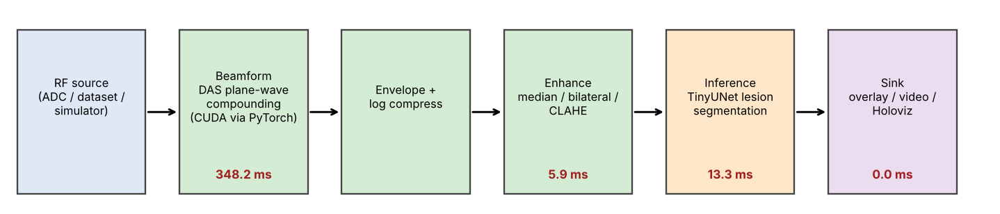
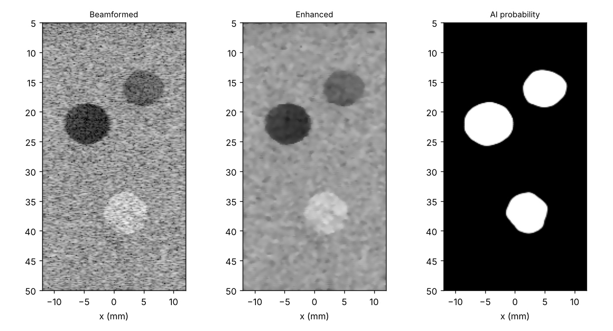

# Real-Time Acceleration for Medical Image Processing (open-source implementation)

An end-to-end, real-time ultrasound pipeline — **raw RF channel data → beamforming → image enhancement → AI lesion segmentation → streaming display** — built entirely with open-source tools (NumPy / SciPy / OpenCV / PyTorch / ONNX), as an alternative to the MATLAB + GPU Coder + Holoscan workflow in MathWorks challenge project #259
([project description](https://github.com/mathworks/MATLAB-Simulink-Challenge-Project-Hub/tree/main/projects/Real-Time%20Acceleration%20for%20Medical%20Image%20Processing)).



*Per-stage times above are measured, serial, 5-angle compounding, 256×128 grid, **4-core CPU, no GPU** (see [What is and isn't validated](#what-is-and-isnt-validated)).*



Demo video (beamformed | enhanced | AI segmentation, 36 streamed frames of simulated moving tissue): [`docs/results/demo.mp4`](docs/results/demo.mp4)

## How this maps to the MathWorks project

| Project step | MATLAB tool in the brief | What this repo uses |
|---|---|---|
| 1. Reconstruct image from raw RF | Phased Array System Toolbox | Delay-and-sum plane-wave compounding: readable NumPy reference (`src/beamforming/delay_and_sum.py`, your original) + fast PyTorch IQ beamformer (`torch_das.py`) |
| 1b. Convert to CUDA | GPU Coder | The PyTorch beamformer runs unchanged on CUDA; geometry is precomputed into look-up tables so each frame is a gather + MAC — the structure of a hand-written CUDA kernel |
| 2. Enhancement | `medfilt2`, `wiener2`, `imbilatfilt`, `adapthisteq` | Median, Wiener, bilateral (torch/GPU-capable + SciPy/OpenCV references) and CLAHE (`src/enhancement/filters.py`) |
| 3. AI detection | Deep Learning Toolbox CNN / U-Net | 121k-parameter U-Net in PyTorch (`src/ai/`), ONNX export for TensorRT / ONNX Runtime |
| 4–5. CUDA + Holoscan | GPU Coder + Holoscan SDK | Holoscan-style operator graph (`src/pipeline/runtime.py`) + a Holoscan SDK app wrapping the same operators (`holoscan_app.py`, **not executed here**) |
| 6. Evaluate | latency, throughput, visual quality | `scripts/benchmark.py`, `evaluate_quality.py`, `evaluate_ai.py`; results below |

## What is and isn't validated

Read this first — it determines how far you can trust the numbers.

* **No real data was processed in the development environment.** Zenodo (the 75-angle plane-wave breast/CIRS phantom dataset your earlier work used) and the other dataset hosts were unreachable from the sandbox. Everything below was measured on **simulated** plane-wave channel data produced by `src/simulation/ultrasound.py` (point-scatterer simulator → real beamforming code). The beamformer geometry is validated against known point-target positions; image-quality and AI numbers are on simulated phantoms with known lesions and **are not clinical evidence**.
* **No GPU was available.** All timings are 4-core CPU. The CUDA path is the same code on `device="cuda"` but its speed is **not measured**; do not read the CPU numbers as the GPU result.
* `scripts/convert_zenodo_mat.py` (real Zenodo `.mat` → pipeline format) follows the layout in your exploration notebook but was **not run on the real files**. Sample-0 time (`--t0`) must be taken from your header. `src/pipeline/holoscan_app.py` was written against the public Holoscan Python API but **never executed** (no Holoscan SDK / NVIDIA GPU).
* ADI ADC hardware was not used; the `RFSource` operator is where an ADC capture stream would plug in.

## Results (simulated data, 4-core CPU)

### Beamforming correctness
Point targets are reconstructed at the true position (|error| < 50 µm lateral / 30 µm axial on a target-centred grid) and amplitudes scale linearly with scatterer strength (0.69 measured for a 0.70 target). Covered by `tests/test_beamforming.py` (14 tests in total pass).

*Design finding:* beamforming real RF on a coarse grid aliases (grid spacing 0.18 mm > λ/2 ≈ 0.1 mm), and linear interpolation of a 7.8 MHz carrier sampled at 31 MHz loses up to 30 % amplitude. The default beamformer therefore demodulates to baseband (IQ) first; this allows the coarse grid and removes the Hilbert transform. `mode="rf"` is kept for comparison.

### Latency / throughput (256×128 grid, serial per-frame, mean over 36 frames)

| Transmit angles | Beamform | Enhance | Inference | **End-to-end** (p95) | Pipelined throughput |
|---|---|---|---|---|---|
| 1 | 62 ms | 5 ms | 13 ms | **81 ms** (105) | 10.2 fps |
| 3 | 238 ms | 6 ms | 14 ms | **257 ms** (308) | 3.9 fps |
| 5 | 348 ms | 6 ms | 13 ms | **367 ms** (466) | 2.6 fps |

* **On this CPU the pipeline is not real-time at 5 angles**; at 1 angle it reaches ~10 fps. Beamforming is ~95 % of the time and is exactly the stage a GPU accelerates — expect the GPU to change the picture, but that is untested here.
* The PyTorch beamformer is ~4× faster than the NumPy reference on the same CPU (60 vs 244 ms for 1 angle; 347 vs 1440 ms for 5).
* Pipelining (threads + bounded queues) raises throughput, but the end-to-end latency measured *inside* the pipelined run (e.g. 1.6 s at 5 angles) is inflated by queueing when the source is unthrottled; the serial figures above are the true per-frame latency.
* Inference: 12 ms (batch 1), 92 frames/s at batch 8 on CPU; ONNX export agrees with PyTorch to 2.5e-5. Full numbers: `docs/results/benchmark.json`.

### Image enhancement (ground-truth lesion masks, 12 frames, 5 angles)

| Filter chain | CNR cyst | CNR hypoechoic | CNR hyperechoic | gCNR cyst |
|---|---|---|---|---|
| none (beamformed) | 2.17 | 1.35 | 1.03 | 0.87 |
| median 3×3 | 3.55 | 2.50 | 1.92 | 0.96 |
| Wiener 5×5 | 3.74 | 3.09 | 2.44 | 0.95 |
| bilateral | 2.85 | 1.91 | 1.41 | 0.92 |
| **median + bilateral (default)** | **4.20** | 3.41 | 2.71 | **0.97** |
| median + bilateral + CLAHE | 3.24 | 3.15 | 2.58 | 0.96 |

Speckle filtering roughly doubles lesion CNR; smoothing costs a little edge sharpness (cyst-boundary gradient 0.148 → 0.115, `quality.json`). CLAHE *lowers* CNR (it amplifies speckle along with contrast) so it is optional, not default. Visual comparison: `docs/results/enhancement_comparison.png`.

### AI lesion segmentation
`TinyUNet` (121k parameters) trained on fast speckle phantoms with domain randomisation (speckle size, depth gain, noise floor, brightness, lesion contrast) and per-frame median normalisation, then evaluated on frames from a **different simulator** (full channel data → beamforming → enhancement), 12 frames, 3 lesions each:

| | Dice | IoU |
|---|---|---|
| on enhanced frames (as deployed) | **0.959** | 0.921 |
| on raw frames | 0.960 | 0.923 |

3.0 detections per frame for 3 true lesions; recall 1.00 / 1.00 / 0.93 (anechoic / hypoechoic / hyperechoic). In-distribution validation Dice is 0.975.

*What went wrong on the way (kept for honesty):* the first model reached Dice 0.93 on raw frames but only 0.48 on enhanced frames, missing the hyperechoic lesion (recall 0.08) — it had learned simulator-specific brightness and speckle statistics and was fed a different distribution than it trained on. Training on enhanced frames alone was not enough (Dice 0.52); domain randomisation + level normalisation fixed it. **Expect the same kind of gap on real BUSI/clinical images — the model has never seen a real image.**

## Quick start

```bash
pip install -r requirements.txt
python -m pytest -q tests                                   # 14 tests
python -m scripts.simulate_dataset --out data/sim_sequence.npz --frames 12
python -m src.ai.train --epochs 10 --n 1500                 # or use the bundled models/tinyunet.pt
python -m scripts.run_pipeline --data data/sim_sequence.npz --frames 36 [--n-angles 1]
python -m scripts.evaluate_quality && python -m scripts.evaluate_ai
python -m scripts.benchmark                                  # uses CUDA automatically if present
python -m scripts.export_onnx                                # needs: pip install onnx onnxscript
```

### Using the real datasets
```bash
# Zenodo 7986407 (your existing data) -> pipeline format (check --t0 against your header!)
python -m scripts.convert_zenodo_mat --glob "7986407/CIRS073_RUMC/**/USDATA_*.mat" \
    --header "7986407/CIRS040GSE/CIRS040GSE/USHEADER_*.mat" --n-angles 5 --out data/zenodo.npz
python -m scripts.run_pipeline --data data/zenodo.npz --frames 30

# Train the segmenter on real breast ultrasound (BUSI, Al-Dhabyani 2020)
python -m src.ai.train --data busi --busi-root path/to/Dataset_BUSI_with_GT
```
`run_pipeline` computes lesion-CNR only for the simulated sequence (it needs known masks); on real data it still produces timings, panels and the video.

### NVIDIA Holoscan deployment
Inside the official Holoscan container: `python -m src.pipeline.holoscan_app --rf data/sim_sequence.npz`. The operators (`RFSource → Beamform → Enhance → Infer → Sink`) are framework-independent callables, so results match the standalone runtime. Treat this file as a starting point: it has not been run.

## Repository layout
```
src/beamforming/   geometry, grid, NumPy reference DAS (your original), torch_das.py (fast, GPU-capable IQ DAS)
src/signal/        NumPy envelope / log compression, torch versions
src/simulation/    point-scatterer channel-data simulator + fast labelled speckle phantoms
src/enhancement/   median / Wiener / bilateral (torch + CPU reference) and CLAHE
src/ai/            TinyUNet, datasets (synthetic, BUSI), training, inference, normalisation
src/pipeline/      Operator/Application streaming runtime, operators, Holoscan app
src/io/            .mat RF + header loaders (your original)
scripts/           simulate, convert real data, run pipeline, benchmark, evaluate, ONNX export
tests/             beamforming geometry, filters/metrics, pipeline runtime
docs/results/      figures, demo video, JSON metrics
```

## Possible next steps
* Run `scripts/benchmark.py` and `run_pipeline.py` on a CUDA machine (and add a fused CUDA/Triton gather kernel — the beamformer is gather-bound).
* Validate on the real Zenodo / USTB data and fine-tune on BUSI; report Dice on real lesions.
* Optional extensions from the brief: optical-flow motion analysis, UNet vs. transformer comparison, real ADI ADC capture into `RFSource`.

## Reference
Project brief: MathWorks MATLAB & Simulink Challenge Project Hub, project 259. Datasets named there: BUSI (Al-Dhabyani et al., *Data in Brief* 2020), Zenodo 545928, Zenodo 7986407, USTB datasets. This implementation was developed independently from the public description.
